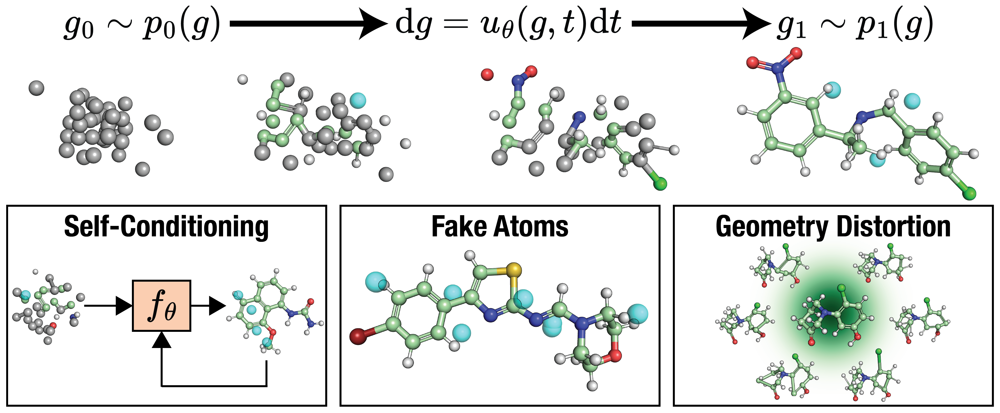

# FlowMol

[FlowMol3: Flow Matching for 3D De Novo Small-Molecule Generation](https://arxiv.org/abs/2508.12629)

## Abstract

A generative model capable of sampling realistic molecules with desired properties could accelerate chemical discovery across a wide range of applications. Toward this goal, significant effort has focused on developing models that jointly sample molecular topology and 3D structure. We present FlowMol3, an open-source, multi-modal flow matching model that advances the state of the art for all-atom, small-molecule generation. Its substantial performance gains over previous FlowMol versions are achieved without changes to the graph neural network architecture or the underlying flow matching formulation. Instead, FlowMol3's improvements arise from three architecture-agnostic techniques that incur negligible computational cost: self-conditioning, fake atoms, and train-time geometry distortion. FlowMol3 achieves nearly 100% molecular validity for drug-like molecules with explicit hydrogens, more accurately reproduces the functional group composition and geometry of its training data, and does so with an order of magnitude fewer learnable parameters than comparable methods. We hypothesize that these techniques mitigate a general pathology affecting transport-based generative models, enabling detection and correction of distribution drift during inference. Our results highlight simple, transferable strategies for improving the stability and quality of diffusion- and flow-based molecular generative models.



---

## Model Description

### Overview
A molecule is represented as:
- atom positions: $X = (x_1, \ldots, x_N),\; x_i \in \mathbb{R}^3$
- atom types (one-hot): $A \in \{0,1\}^{N \times K}$
- formal charges (one-hot): $C \in \{0,1\}^{N \times 6}$
- bond orders (one-hot, upper triangle of the complete graph): $E \in \{0,1\}^{M \times 4}$

The training objective interpolates between a prior (a centered Gaussian for
positions, the mask token for every categorical feature) and the data
endpoint, and trains a GVP message passing network to predict the endpoint
$x_1$ from the interpolated state $x_t$.

### Method

#### 1) CTMC probability paths for categorical features
Every categorical feature follows the CTMC probability path of discrete flow
matching. With the mask token as the prior state, the feature is revealed
node-by-node with probability $\alpha(t)$:

$$
p(a_t \mid a_1) = (1 - \alpha_t)\,\delta_{\mathrm{mask}} + \alpha_t\,\delta_{a_1}.
$$

The training target is the true endpoint category, restricted to nodes whose
state is still masked (`ignore_index=-100`); already revealed nodes carry no
supervision signal.

#### 2) Linear interpolation paths for positions
Positions follow the linear probability path

$$
x_t = (1 - \alpha_t)\,x_0 + \alpha_t\,x_1,
$$

where $x_0$ is a centered Gaussian prior aligned to $x_1$ with an optimal
assignment (Hungarian) followed by a rigid Kabsch alignment. The training
target is the endpoint $x_1$ (the "endpoint" parameterization of the velocity
field).

#### 3) GVP denoiser
The endpoint predictor is a Geometric Vector Perceptron (GVP) network over
the batched complete graph: scalar node features (atom/charge/time
embeddings), vector features, edge features and radial basis function
distance embeddings are processed by repeated rounds of message passing,
node position updates and edge updates. An optional self-conditioning
residual layer feeds the previous endpoint prediction back into the
network.

#### 4) Loss
$$
\mathcal{L} = \sum_{f \in \{x, a, c, e\}} w_f\, \mathcal{L}_f,
$$

with MSE for positions and cross entropy for the categorical features, both
optionally scaled by the time-dependent weights
$\mathrm{clip}(\alpha_t / (1-\alpha_t), 0.05, 1.5)$.

#### 5) Sampling
Sampling integrates the learned endpoint field with an Euler scheme over
`tspan = [0, 1]` (250 steps by default). At every step, masked nodes are
stochastically unmasked towards sampled endpoint categories (Campbell
discrete flow, with optional purity sampling that favors high-confidence
predictions) and can be re-masked; positions follow the Euler update.

---

## Dataset Description

### Dataset contents

#### 1) flowmol_qm9 (training subset used in this repository)
The FlowMol released model is trained on GEOM-Drugs. The training entry in
this repository uses the QM9 subset processed by the upstream `process_qm9.py`
pipeline (96,334 training / 19,775 validation / 12,903 test molecules,
elements C/H/N/O/F). The package provides the processed splits consumed by
`flowmol_qm9.yaml` (positions, one-hot atom types, formal charges, upper
triangle bond types plus the atom-count histogram) and is downloaded
automatically by `download.get_datasets_path_from_url` when a split file is
missing.

#### 2) flowmol3_geom_hist (atom-count histogram of the released model)
The GEOM-Drugs atom-count histogram consumed by `flowmol3.yaml` is inlined in
`ppmat/datasets/flowmol_dataset.py`; no download is required.

### Data format (recommended)
Each molecule sample provides:
- `positions`: $N \times 3$ COM-free atom coordinates
- `atom_types`: one-hot atom types (elements C/H/N/O/F)
- `atom_charges`: one-hot formal charges (6 classes)
- `bond_types`: upper-triangle one-hot bond orders (4 classes)

The aligned Gaussian prior `prior_positions` is additionally required by the
flow matching training path.

#### flowmol_qm9 split (download link)
| Dataset | Train | Val | Test |
| --- | --- | --- | --- |
| [flowmol_qm9](https://paddle-org.bj.bcebos.com/paddlematerials/datasets/flowmol_qm9/flowmol_qm9.zip) | 96334 | 19775 | 12903 |

---

## Results

| Model | Dataset | frac_valid_mols (RDKit) | Config | Checkpoint / Log |
| --- | --- | --- | --- | --- |
| flowmol3 | geom_drugs (upstream training) | 8/8 molecules decoded (50-step smoke) | [flowmol3.yaml](./flowmol3.yaml) | [flowmol3.zip](https://paddle-org.bj.bcebos.com/paddlematerials/checkpoints/structure_generation/flowmol/flowmol3.zip) |

Sampling determinism note: molecule generation is stochastic; the reported
number is a smoke-level sanity check of the registered checkpoint, not a
paper-metric reproduction. The upstream paper metrics (validity, uniqueness,
novelty) require the full GEOM-Drugs evaluation stack.

---

## Command

### Training
```bash
# multi-gpu training (example with 4 GPUs)
python -m paddle.distributed.launch --gpus="0,1,2,3" structure_generation/train.py -c structure_generation/configs/flowmol/flowmol_qm9.yaml
# single-gpu training
python structure_generation/train.py -c structure_generation/configs/flowmol/flowmol_qm9.yaml
```

### Validation
```bash
# Adjust program behavior on the fly using command-line parameters without modifying the configuration file directly.
# Example: --Global.do_eval=True
python structure_generation/train.py -c structure_generation/configs/flowmol/flowmol_qm9.yaml Global.do_eval=True Global.do_train=False Global.do_test=False Trainer.pretrained_model_path='path/to/model.pdparams'
```

### Testing
```bash
# Evaluate the model on the test dataset.
python structure_generation/train.py -c structure_generation/configs/flowmol/flowmol_qm9.yaml Global.do_eval=False Global.do_train=False Global.do_test=True Trainer.pretrained_model_path='path/to/model.pdparams'
```

### Sample
```python
# Molecular models sample through the framework-level MolecularSampler.
# Mode 1: Use a pre-trained model (downloads automatically from MODEL_REGISTRY).
# Mode 2: Use a custom configuration file and checkpoint.

# Mode 1: pre-trained model
from ppmat.sampler import MolecularSampler

sampler = MolecularSampler(
    model_name="flowmol3",
    config_overrides=[
        "Sampler.data.dataset.__init_params__.total_num=16",
        "Sampler.model_sample_params.num_inference_steps=250",
        "Sampler.output_dir=./output/flowmol3_samples",
    ],
)
results = sampler.sample_by_dataloader()
sampler.model.save_samples(results["pred"], sampler.output_dir)

# Mode 2: custom config + checkpoint
sampler = MolecularSampler(
    config_path="structure_generation/configs/flowmol/flowmol_qm9.yaml",
    checkpoint_path="./output/flowmol_qm9_t_<time>_s_42/checkpoints/best.pdparams",
    config_overrides=[
        "Dataset.train=null",
        "Sampler.data.dataset.__init_params__.total_num=16",
        "Sampler.model_sample_params.num_inference_steps=250",
        "Sampler.output_dir=./output/flowmol_qm9_samples",
    ],
)
results = sampler.sample_by_dataloader()
sampler.model.save_samples(results["pred"], sampler.output_dir)
```

---

## Citation
```
@article{dunn2025flowmol3,
  title={FlowMol3: Flow Matching for 3D De Novo Small-Molecule Generation},
  author={Dunn, Ian and Koes, David Ryan},
  journal={arXiv preprint arXiv:2508.12629},
  year={2025}
}
```
