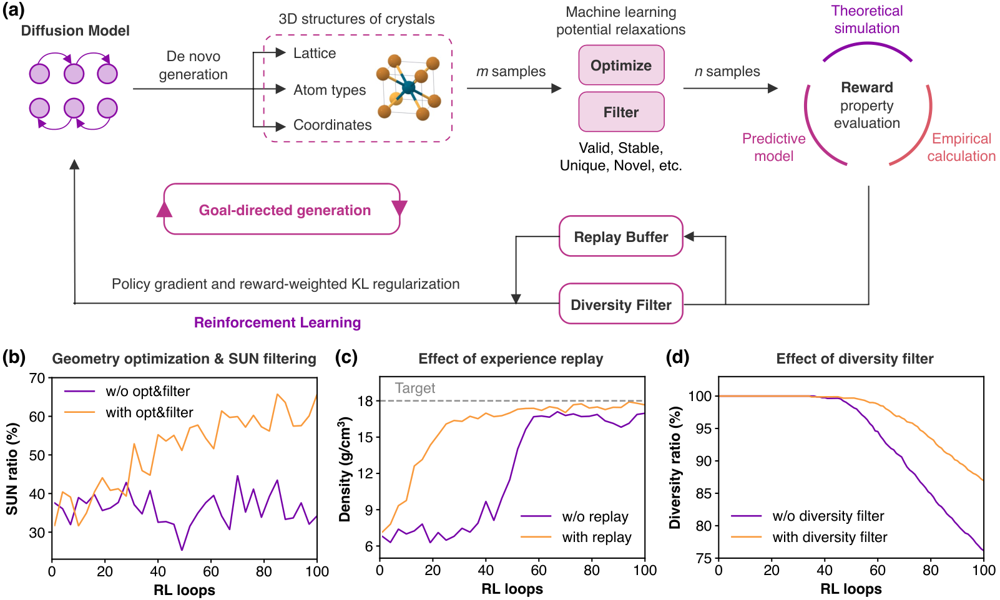

# MatInvent

[MatInvent: Accelerating inverse materials design using generative diffusion models with reinforcement learning](https://arxiv.org/abs/2511.03112)

## Abstract

MatInvent is a general and efficient reinforcement learning workflow that optimizes diffusion models for goal-directed crystal generation. MatInvent enables robust optimization for inverse material design tasks with single or multiple target properties. Compatible with diverse diffusion model architectures and property constraints, MatInvent could offer broad applicability in materials discovery.



---

## Model Description

### Overview
MatInvent adapts pretrained crystal diffusion models for goal-directed materials generation through reinforcement learning. Each round generates crystal structures, evaluates their properties, and fine-tunes the generator using the resulting rewards. The implementation supports MatterGen and DiffCSP backbones.

| Backbone | Generation task | Config |
| --- | --- | --- |
| MatterGen | Joint generation of atom types, coordinates, and lattice | [matinvent_mattergen.yaml](matinvent_mattergen.yaml) |
| DiffCSP | Coordinate and lattice generation with fixed atom types | [matinvent_diffcsp.yaml](matinvent_diffcsp.yaml) |
| DiffCSP | Joint generation of atom types, coordinates, and lattice | [matinvent_diffcsp_joint.yaml](matinvent_diffcsp_joint.yaml) |

The MatterGen and conditional DiffCSP configurations optimize density. The joint DiffCSP configuration optimizes the Herfindahl-Hirschman Index (HHI) for supply risk, with relaxation, stability, novelty, and uniqueness screening. Reward properties and targets are configured under `Model.__init_params__.rl_cfg.reward_cfg`.

### Method
For a generated structure with reward $r$, fine-tuning minimizes the reward-weighted diffusion objective with regularization toward a frozen pretrained prior:

$$
\mathcal{L} = r\,\mathcal{L}_{\mathrm{diff}} + \sigma\,(1.1-r)\,\mathcal{L}_{\mathrm{prior}}.
$$

Here, $\mathcal{L}_{\mathrm{diff}}$ combines the coordinate, lattice, and, for joint generation, atom-type denoising losses. $\mathcal{L}_{\mathrm{prior}}$ measures the mean squared difference between the agent and prior predictions; $\sigma$ controls its weight.

Structures are ranked by reward before fine-tuning. A replay buffer retains high-reward structures, while a composition-based diversity filter reduces rewards for repeatedly generated compositions. The agent and frozen prior are initialized from the same pretrained backbone. RL sampling reuses `NumAtomsCrystalDataset` for Alex-MP-20 counts and draws joint MP-20 counts inside MatInvent, with `BuildStructure` for structure parsing. A single adapter samples the current in-memory agent; conditional DiffCSP additionally receives random atom types. Model execution errors propagate to the caller.

---

## Dataset Description

RL training uses generated structures and property rewards rather than a fixed labeled training split. The standard configurations draw atom counts from the Alex-MP-20 distribution, with 1 to 20 atoms per structure. The joint DiffCSP configuration uses the MP-20 atom-count distribution and retains at most 16 qualified structures per RL round. For joint dataloader sampling, `Sample.model_sample_params.atom_count_distribution` selects MP-20 inside the model; explicit atom counts and chemical-formula inputs retain their requested sizes. The shared dataset distribution registry is unchanged.

| Data | Usage | Source |
| --- | --- | --- |
| Generated crystals | Online reward evaluation and fine-tuning | Current diffusion model |
| Pretrained backbones | Agent and frozen-prior initialization | Registered MatInvent packages; original checkpoints are available on [Hugging Face](https://huggingface.co/jwchen25/MatInvent) |
| MP-20 validation structures | Joint DiffCSP validation probe | [MP-20](https://paddle-org.bj.bcebos.com/paddlematerial/datasets/mp_20/mp_20.zip) |
| MP2020-corrected reference database | Joint DiffCSP stability and novelty screening | [reference_MP2020correction.gz](https://huggingface.co/jwchen25/MatInvent/blob/main/reference_MP2020correction.gz) |

For joint DiffCSP training, place the reference archive at `data/matinvent/reference_MP2020correction.gz` and the MP-20 validation file at `data/mp_20/val.csv`, or update `qualification_cfg.reference_path` and `early_stop_cfg.probe_cfg.data_path` under `Model.__init_params__.rl_cfg`. Relaxation uses the registered `mattersim_5M` model.

---

## Results

| Model Name | Dataset | Evaluation (pretrained -> RL) | Config | Checkpoint / Log |
| --- | --- | --- | --- | --- |
| matinvent_mattergen_mp20 | MP-20 validation / generated crystals | Val loss: 0.3874 -> 0.4949<br>Density: 6.420 -> 7.195<br>Valid: 71.88% -> 65.62%<br>Target success: 42.71% -> 42.71% | [matinvent_mattergen.yaml](matinvent_mattergen.yaml) | [pretrained checkpoint](https://paddle-org.bj.bcebos.com/paddlematerials/checkpoints/structure_generation/MatInvert/matinvent_mattergen_mp20.zip) |
| matinvent_diffcsp_mp20 | MP-20 validation / generated crystals | Val loss: 1.0012 -> 0.9863<br>Density: 11.019 -> 10.728<br>Valid: 32.29% -> 32.29%<br>Target success: 32.29% -> 32.29% | [matinvent_diffcsp.yaml](matinvent_diffcsp.yaml) | [pretrained checkpoint](https://paddle-org.bj.bcebos.com/paddlematerials/checkpoints/structure_generation/MatInvert/matinvent_diffcsp_mp20.zip) |
| matinvent_diffcsp_mp20_joint | MP-20 validation / generated crystals | Val loss: 1.0196 -> 1.0601<br>HHI: 2552.54 -> 2318.80<br>Valid: 87.50% -> 86.46%<br>Qualified: 16.67% -> 18.75%<br>Target success: 1.04% -> 2.08% | [matinvent_diffcsp_joint.yaml](matinvent_diffcsp_joint.yaml) | [pretrained checkpoint](https://paddle-org.bj.bcebos.com/paddlematerials/checkpoints/structure_generation/MatInvert/matinvent_diffcsp_mp20_joint.zip) |

Results were measured on 2026-10-26 with Paddle 3.3.0 in eager mode on one RTX 5090 D. Each model completed 10 RL rounds with its configured optimizer, fine-tuning epochs and noise schedule. Conditional DiffCSP and MatterGen used training seed 42 and 16 candidates per round; joint DiffCSP used seed 43 and 32 candidates, retaining the default qualification thresholds and early-stop checks. The final checkpoint was selected without evaluation-based checkpoint selection. Validation loss uses all 9,047 MP-20 validation structures, batch size 32 and fixed noise seed 2026102699. Generation uses the same three independent evaluation seeds (2026102601, 2026102602 and 2026102603) before and after training, with 32 structures per seed and batch size eight; decoding uses 1,000 steps for DiffCSP and 50 for MatterGen.

Validity follows the geometric and SMACT checks used by RL training. All generation rates use all 96 requested structures as the denominator. Target success requires density of at least 5 g/cm3 for the standard models, or HHI of at most 1,250 after qualification for joint DiffCSP. Joint qualification requires converged relaxation, validity, stability, novelty and uniqueness within each seed's 32 candidates. Density is averaged over valid structures; HHI is averaged over qualified structures with finite property values (15 before and 18 after). One missing baseline HHI value is excluded from the property mean but retains zero reward and remains in the success-rate denominator.

The results are mixed: joint HHI and qualification improve, while MatterGen validity and validation loss deteriorate. This single-training-seed, 10-round comparison does not establish full RL convergence or statistically significant improvement. The linked checkpoints initialize the pretrained backbones and are not the fine-tuned experiment outputs. The DiffCSP registry entries temporarily use the local model server; the checkpoint links above are the publication destinations.

---

## Command

### Training
```bash
# MatterGen backbone
python structure_generation/train.py -c structure_generation/configs/matinvent/matinvent_mattergen.yaml

# DiffCSP backbone with fixed atom types
python structure_generation/train.py -c structure_generation/configs/matinvent/matinvent_diffcsp.yaml

# Joint DiffCSP generation; prepare the reference database and validation data first
python structure_generation/train.py -c structure_generation/configs/matinvent/matinvent_diffcsp_joint.yaml
```

RL checkpoint files contain backbone weights for sampling. Resuming RL training through `Trainer.resume_from_checkpoint` is unsupported because the RL optimizer, replay buffer, and round state are not saved. This configuration is rejected before the RL loop starts; start a new run instead.

### Validation
The RL loop reports rewards, property means, and retained structure counts after each round. Joint DiffCSP additionally evaluates the MP-20 probe configured under `Model.__init_params__.rl_cfg.early_stop_cfg`. The configurations do not define a standalone validation split for the unified trainer.

### Testing
The configurations do not define a test split. Use the sampling commands below to generate structures from a pretrained or fine-tuned checkpoint.

### Sample
```bash
# Predict crystal structures using a trained model.
# Mode 1: Use a pre-trained model (downloads automatically).
# Mode 2: Use a custom configuration file and checkpoint.
# Results are saved to the folder specified by --output_path (default: results).

# Mode 1: pre-trained MatterGen backbone
python structure_generation/sample.py --model_name='matinvent_mattergen_mp20' --output_path='result_matinvent_mattergen/' --mode='by_dataloader'

# Mode 2: MatterGen checkpoint produced by an RL run
python structure_generation/sample.py --config_path='structure_generation/configs/matinvent/matinvent_mattergen.yaml' --checkpoint_path='<run_dir>/models/final/model.pdparams' --output_path='result_matinvent_mattergen/' --mode='by_dataloader'

# Mode 2: conditional DiffCSP checkpoint; the formula supplies the atom types
python structure_generation/sample.py --config_path='structure_generation/configs/matinvent/matinvent_diffcsp.yaml' --checkpoint_path='<run_dir>/models/final/model.pdparams' --output_path='result_matinvent_diffcsp/' --mode='by_chemical_formula' --chemical_formula='LiMnO2'
```

---

## Citation
```
@article{matinvent,
  title={Accelerating inverse materials design using generative diffusion models with reinforcement learning},
  author={Chen, Junwu and Guo, Jeff and Fako, Edvin and Schwaller, Philippe},
  journal={arXiv preprint arXiv:2511.03112},
  year={2025}
}
```
