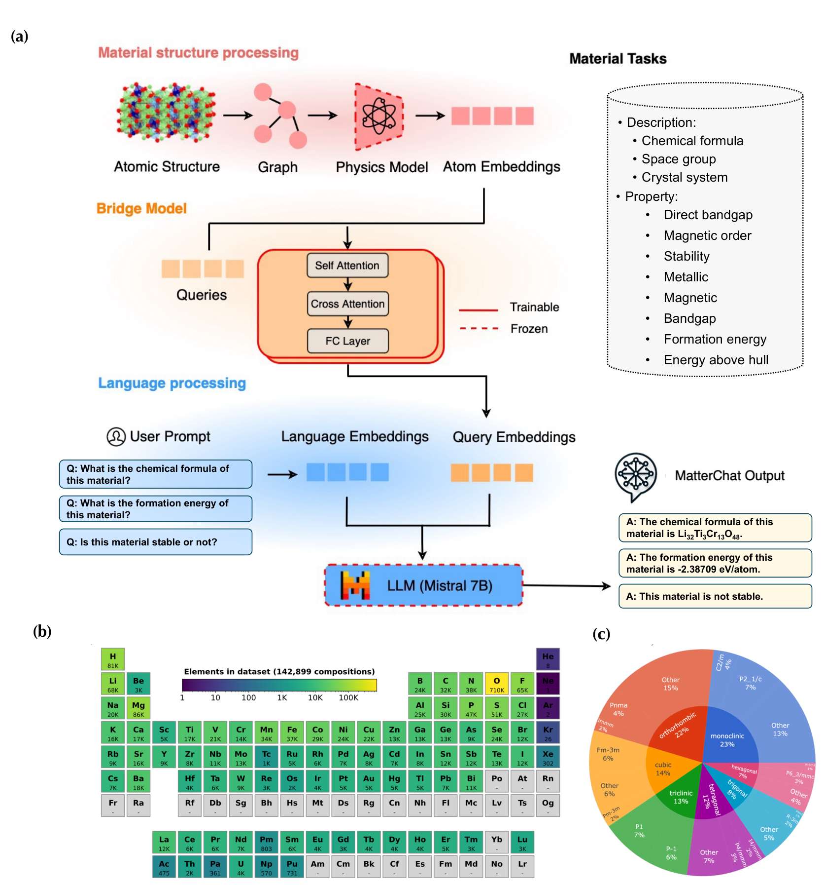

# MatterChat

[A conversational crystal-material AI based on BLIP-2 + Mistral-7B + CHGNet](https://arxiv.org/abs/2502.13107)

## Abstract

MatterChat is a multimodal large language model for crystal materials. It adopts the BLIP-2 architecture to bridge a crystal structure encoder (CHGNet) with a large language model (Mistral-7B-Instruct) via a Q-Former, enabling natural-language question answering about a given crystal structure. Given a CIF file and a text prompt, MatterChat answers questions such as the chemical formula, space group, stability, and band gap. It is an inference / dialogue model, not a structure generator: it does not produce new crystal structures, but reasons about an input structure through language.



---

## Model Description

### Overview

MatterChat follows the BLIP-2 three-module design, adapted from image-text to crystal-text:

```
CIF (pymatgen Structure)
  -> CHGNet encoder          : [N_atom, 64] per-atom embeddings
  -> Q-Former (BERT + cross) : [num_query_token, 768] query embeddings
  -> llm_proj (Linear)       : [num_query_token, 4096] LLM input embeddings
  -> Mistral-7B LLM          : generated text answer
```

A crystal is represented by its unit cell:

- atom types: $A = (a_1,\ldots,a_N)$
- fractional coordinates: $X = (x_1,\ldots,x_N),\; x_i \in [0,1)^3$
- lattice: $L \in \mathbb{R}^{3 \times 3}$

### Method

#### 1) CHGNet material encoder

CHGNet encodes the crystal graph (atoms, bonds, angles) into per-atom embeddings of dimension 64. The crystal graph is constructed via a radius-based neighbor search with periodic boundary conditions:

$$
\tilde{X} = X + L^\top k, \qquad k \in \mathbb{Z}^3
$$

$$
d_{ij} = \|\tilde{x}_i - x_j\|_2, \qquad \text{kept if } d_{ij} < r_{\text{cut}}
$$

The encoder is frozen during all training stages.

The material encoder subclasses the framework CHGNet and uses its
`CHGNetGraphConverter`, basis functions, message-passing layers and graph
execution. The MatterChat adapter retains the released checkpoint layout:
9 radial/angular bases, 5/3 angstrom atom/bond cutoffs, cutoff coefficient 5,
a two-layer 64-wide readout MLP and biased convolution output projections.
Identity layers replace gated normalization only in this adapter, and readout
normalization is disabled, matching the released dialogue weights. A scoped
forward hook reads final atom-convolution features; it is removed even if graph
execution fails. The framework's `return_atom_feas` refers to the penultimate
features and is therefore not used for dialogue embeddings. The framework
CHGNet source and its defaults are unchanged.

#### 2) Q-Former (cross-attention bridge)

A BERT-style transformer with cross-attention layers. A fixed set of learnable query tokens $Q \in \mathbb{R}^{N_q \times d}$ attend to the CHGNet embeddings $E \in \mathbb{R}^{N \times 64}$:

$$
Q' = \text{CrossAttn}(Q,\; E,\; E) = \text{softmax}\!\left(\frac{Q W_q (E W_k)^\top}{\sqrt{d_k}}\right) E W_v
$$

producing a compact material representation of shape $[N_q, 768]$ that is independent of the atom count $N$.

#### 3) Projection + Mistral LLM

A linear layer maps Q-Former outputs to the LLM hidden size (4096):

$$
Z = Q' W + b, \qquad Z \in \mathbb{R}^{N_q \times 4096}
$$

The projected embeddings $Z$ are concatenated with tokenized prompt embeddings $T$ and fed to Mistral-7B-Instruct, which generates the answer autoregressively:

$$
P(y_t \mid y_{<t},\; Z,\; T) = \text{softmax}(\text{LLM}([Z;\,T;\,y_{<t}]))
$$

#### 4) Released checkpoint

The released checkpoint corresponds to the BLIP-2 stage-2 product: the
Q-Former and llm_proj are trained, while the CHGNet encoder and the Mistral
LLM stay frozen. The dialogue pipeline supports inference and bridge training
through the existing `BaseTrainer`. Training consumes precomputed frozen-CHGNet
features; it does not implement the full original three-stage training procedure.

Use the standard `Model.__class_name__` / `Model.__init_params__` configuration.
Mistral settings are a YAML mapping under `Model.__init_params__.llm_config`;
`MistralConfig` is an internal typed dataclass, not a separately registered model
or an external framework configuration object. `matterchat_full.yaml` lists the
released backbone dimensions explicitly. Omitted fields use the dataclass
defaults, which describe the same architecture. Unknown fields and incompatible
attention dimensions raise errors instead of silently accepting unused options.
Unused external configuration fields (`head_dim`, `sliding_window`,
`tie_word_embeddings`, `num_labels`, `model_type`) are not supported; the previous
implementation accepted them without applying them to the model. Attention is
selected explicitly using `attn_implementation: eager` or `sdpa`.

---

## Dataset Description

MatterChat pairs a crystal structure with a question and generates a text answer.
Inference accepts a pymatgen `Structure` and a prompt; no dataset download is
required. Bridge training uses caller-provided frozen-CHGNet features and Q&A.

| Dataset | Train | Val | Test |
| --- | --- | --- | --- |
| Local crystal Q&A NPZ archives | Caller-defined | Caller-defined | Caller-defined |

No standard training split or downloadable training corpus is registered for this
adapter. Prepare independent archives for training, validation and testing.

Provide your own local NPZ file with these arrays (no pickle objects):

| Array | Shape | Type | Meaning |
| --- | --- | --- | --- |
| `material_embedding` | `[sum(num_atoms), 64]` | float32 | Per-atom CHGNet embeddings concatenated in record order |
| `num_atoms` | `[records]` | integer | Positive atom count for each record |
| `text_input` | `[records]` | Unicode string | Questions |
| `text` | `[records]` | Unicode string | Nonempty target answers without manually added BOS/EOS |

Extract features with the same frozen CHGNet weights used for dialogue inference.
Set the loaded model to `eval()` and call
`model.material_encoder.predict_structure_embedding(structure)` under
`paddle.no_grad()`. Concatenate those arrays with `numpy.concatenate`, and save
all four fields using `numpy.savez`. This is a caller-provided dataset, so missing
files raise an error rather than downloading an unrelated corpus. Split training
and validation records before saving separate archives.

`MatterChatDataset` returns plain dictionaries. `ConcatData` packs variable atom
counts through `DefaultCollator`; the model pads features and masks padded atoms
before Q-Former attention. Answers are tokenized without automatic special
tokens, with EOS appended explicitly. The loss supervises every answer token and
masks question tokens, the crystal prefix and padding.

---

## Results

| Model | Dataset | GPUs | Training Time | Config | Checkpoint / Log |
| --- | --- | --- | --- | --- | --- |
| matterchat_full | Crystal Q&A instruction data | Not recorded | Not recorded | [matterchat_full.yaml](matterchat_full.yaml) | [checkpoint / log](https://paddle-org.bj.bcebos.com/paddlematerials/checkpoints/llm/MatterChat/matterchat_full.zip) |
| MatterChat bridge training | Local crystal Q&A NPZ archives | 1 (smoke test) | Not benchmarked | [matterchat_train.yaml](matterchat_train.yaml) | Not published |

Previously documented dialogue examples (greedy decoding, float32):

| Crystal | Chemical Formula | Space Group | Stable | Band Gap |
| --- | --- | --- | --- | --- |
| Si | Si | Cmcm | No | 0.68795 |
| GaN | GaN | P6_3mc | No | 1.68300 |

These examples are generated answers, not verified reference labels or benchmark
accuracy measurements. Full-checkpoint dialogue quality has not been rerun after
the current refactor.

---

## Command

### Training

Use the existing training entry with `MatterChatDataset`, `DefaultCollator`, the
optimizer factory and `BaseTrainer`. CHGNet and Mistral remain frozen; Q-Former,
query tokens and the projection are optimized.

```bash
python structure_generation/train.py \
  -c structure_generation/configs/matterchat/matterchat_train.yaml \
  Model.__init_params__.tokenizer_path=./data/matterchat/tokenizer.json \
  Dataset.train.dataset.__init_params__.path=./data/matterchat/train.npz
```

This configuration constructs the full-size model with random initialization.
To fine-tune a released model, set `Trainer.pretrained_model_path` to the extracted
checkpoint directory containing `best.pdparams`. Use the tokenizer from that same
package. Sharded packages must first be exported to a native `best.pdparams`
checkpoint with matching configuration; the Trainer's standard weight loader does
not use MatterChat's inference-only sharded loader. Full-model training memory
requirements are higher than inference even with a frozen LLM.

The integration test uses a small LLM with real CHGNet-derived variable-length
features and synthetic Q&A. It covers finite gradients, parameter updates,
frozen weights, evaluation and independent model/optimizer checkpoint restoration.
Full-size fine-tuning quality has not been established.

For resume, set `Trainer.resume_from_checkpoint` to a checkpoint prefix, such as
`./output/run/checkpoints/latest`, without a file extension.

### Validation

Evaluate answer-token loss on an independent validation archive. Provide the
matching tokenizer and native checkpoint. The command supplies the optional
validation dataset block through standard configuration overrides.

```bash
python structure_generation/train.py \
  -c structure_generation/configs/matterchat/matterchat_train.yaml \
  Global.do_train=False Global.do_eval=True Global.do_test=False \
  Model.__init_params__.tokenizer_path=./data/matterchat/tokenizer.json \
  Trainer.pretrained_model_path=./output/run/checkpoints/latest.pdparams \
  Dataset.val.dataset.__class_name__=MatterChatDataset \
  Dataset.val.dataset.__init_params__.path=./data/matterchat/val.npz \
  Dataset.val.sampler.__class_name__=BatchSampler \
  Dataset.val.sampler.__init_params__.batch_size=2 \
  Dataset.val.sampler.__init_params__.shuffle=False \
  Dataset.val.sampler.__init_params__.drop_last=False
```

### Testing

Evaluate answer-token loss on a held-out test archive. This measures the language
model training objective; it does not compute factual-answer accuracy.

```bash
python structure_generation/train.py \
  -c structure_generation/configs/matterchat/matterchat_train.yaml \
  Global.do_train=False Global.do_eval=False Global.do_test=True \
  Model.__init_params__.tokenizer_path=./data/matterchat/tokenizer.json \
  Trainer.pretrained_model_path=./output/run/checkpoints/latest.pdparams \
  Dataset.test.dataset.__class_name__=MatterChatDataset \
  Dataset.test.dataset.__init_params__.path=./data/matterchat/test.npz \
  Dataset.test.sampler.__class_name__=BatchSampler \
  Dataset.test.sampler.__init_params__.batch_size=2 \
  Dataset.test.sampler.__init_params__.shuffle=False \
  Dataset.test.sampler.__init_params__.drop_last=False
```

### Sample

Sampling produces dialogue text through `chat()`. The structure-generation
`StructureSampler` entry is not used because this model does not generate CIFs.
The tokenizer is supplied as `tokenizer.json` in the checkpoint package. For a
custom model configuration, set `Model.__init_params__.tokenizer_path` to the
matching tokenizer file before building the model.

```python
# Mode 1: automatically download the registered checkpoint package.
import paddle
from pymatgen.core import Structure

from ppmat.models import Blip2MistralInstruct
from ppmat.models import MODEL_REGISTRY
from ppmat.models import resolve_model_package_dir
from ppmat.utils.download import get_weights_path_from_url

paddle.set_device("gpu:0")
model_name = "matterchat_full"
extracted_path = get_weights_path_from_url(MODEL_REGISTRY[model_name])
package_path = resolve_model_package_dir(model_name, extracted_path)
model = Blip2MistralInstruct.from_pretrained(package_path)
model.eval()
structure = Structure.from_file("Si.cif")
print(model.chat(structure, "what is the chemical formula of this material?"))
```

```python
# Mode 2: custom YAML configuration and native checkpoint.
import paddle
from omegaconf import OmegaConf
from pymatgen.core import Structure

from ppmat.models import build_model
from ppmat.utils import save_load

paddle.set_device("gpu:0")
config_path = "structure_generation/configs/matterchat/matterchat_full.yaml"
config = OmegaConf.load(config_path)
config.Model.__init_params__.tokenizer_path = "./matterchat_full/tokenizer.json"
model = build_model(OmegaConf.to_container(config.Model, resolve=True))
save_load.load_pretrain(model, "./matterchat_full/checkpoints/best.pdparams")
model.eval()
structure = Structure.from_file("Si.cif")
print(model.chat(structure, "what is the chemical formula of this material?"))
```

Mode 1 also supports the model's sharded checkpoint loader. Mode 2 requires a
native `.pdparams` checkpoint matching the custom configuration.

MatterChat defaults to eager execution. The top-level model delegates backend
selection to its existing Mistral backbone, which owns the shared runtime and
its cache. CINN compiles that backbone's numerical forward through SOT; CHGNet,
Q-Former, the language head and the generation loop stay eager. Checkpoint keys
and shapes are unchanged. The training configuration uses eager execution;
the CINN coverage below is for inference.

After loading the model on a CUDA device, select the backend before calling the
existing chat entry:

```python
import paddle

paddle.set_flags({"FLAGS_enable_fuse_parallel_matmul_pass": False})
model.set_execution_backend("cinn")
model.validate_execution_backend(use_amp=False, world_size=1)
answer = model.chat(
    structure, "what is the chemical formula of this material?", max_new_tokens=4
)
```

The full 7B FP32 model on a 32 GB GPU needs the public flag shown above before
the first CINN call. The default pass combines parallel matrix multiplications
and materializes large concatenated weights; the measured default configuration
ran out of device memory. This flag changes compiler optimization, not model
weights or precision. Use the same flag setting in both benchmark modes.

The GPU integration test covers greedy chat with the autoregressive KV cache.
The default CINN option is `full_graph=False`; AMP and distributed CINN are not
supported by the shared execution backend.

---

## Citation

```
@misc{matterchat2025,
  title={MatterChat: A conversational crystal-material AI based on BLIP-2.},
  author={PaddleMaterials Contributors},
  year={2025}
}
@article{li2023blip,
  title={Blip-2: Bootstrapping language-image pre-training with frozen image encoders and large language models},
  author={Li, Junnan and Li, Dongxu and Savarese, Silvio and Hoi, Steven},
  journal={arXiv preprint arXiv:2301.12597},
  year={2023}
}
```
