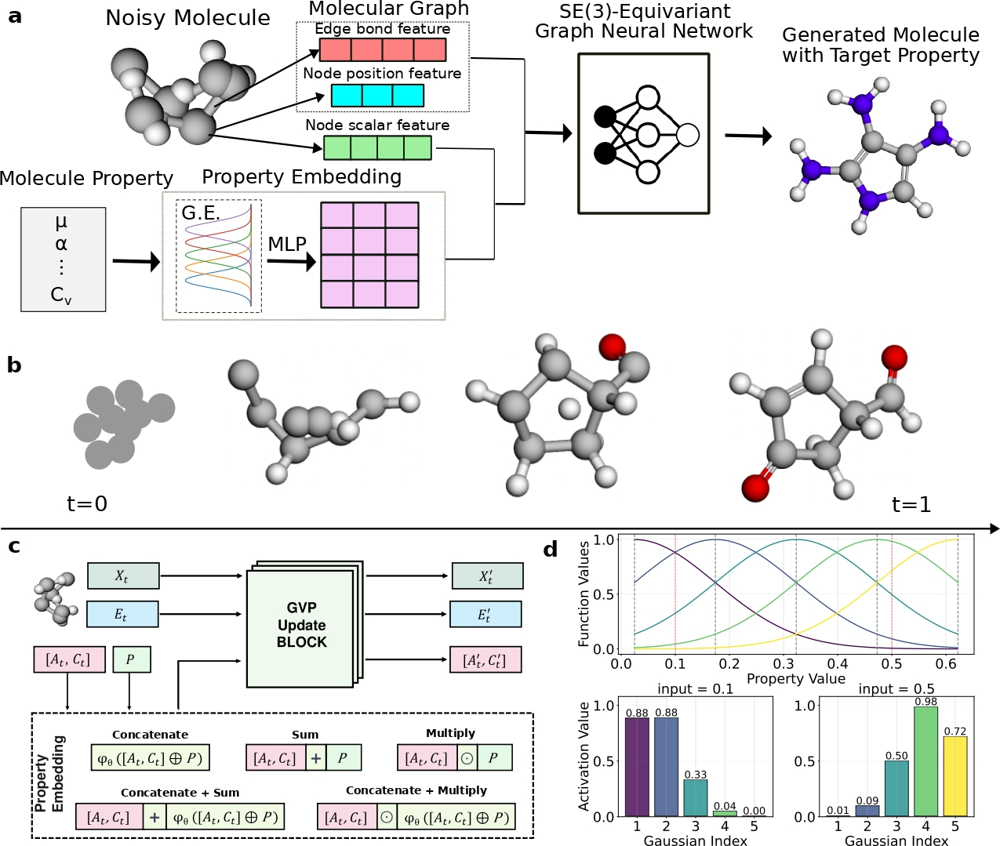

# PropMolFlow

[PropMolFlow: property-guided molecule generation with geometry-complete flow matching](https://www.nature.com/articles/s43588-025-00946-y)

## Abstract

Molecule generation is advancing rapidly in chemical discovery and drug design. Flow-matching methods have recently set the state of the art (SOTA) in unconditional molecule generation, surpassing score-based diffusion models. However, diffusion models still lead in property-guided generation. In this work, we introduce PropMolFlow, an approach for property-guided molecule generation based on geometry-complete SE(3)-equivariant flow matching. Integrating five different property embedding methods with a Gaussian expansion of scalar properties, PropMolFlow achieves competitive performance against previous SOTA diffusion models in conditional molecule generation while maintaining high structural stability and validity. Additionally, it enables higher sampling speed with fewer time steps compared with baseline models. We highlight the importance of validating the properties of generated molecules through density functional theory calculations. Furthermore, we introduce a task to assess the model's ability to propose molecules with under-represented property values, assessing its capacity for out-of-distribution generalization.



---

## Model Description

### Overview
A molecule is represented as a complete atom graph with:
- atom types (composition): $A = (a_1,\ldots,a_N)$
- formal charges: $C = (c_1,\ldots,c_N)$
- 3D coordinates: $X = (x_1,\ldots,x_N),\; x_i \in \mathbb{R}^3$
- bond types: $E$ over every atom pair

PropMolFlow is a geometry-complete SE(3)-equivariant flow matching model for **property-guided molecule generation**. It defines separate flow-matching probability paths for the discrete features (atom types, charges, bond types) and the continuous coordinates, and trains a GVP (Geometric Vector Perceptron) message passing network to predict the trajectory endpoint. The target molecular property is injected into the network through a property embedding module.

### Method

#### 1) Geometry-complete probability paths
The interpolant scheduler assigns a time-dependent weight $\alpha_t \in [0,1]$ to every feature. Coordinates follow linear interpolation between a centered-normal prior $x_0$ and the data coordinate $x_1$:

$$
x_t = (1 - \alpha_t)\, x_0 + \alpha_t\, x_1,
\qquad
v_t = \frac{\alpha_t'}{1 - \alpha_t}\,(x_1 - x_t).
$$

The categorical features (atom types, charges, bond types) follow CTMC (continuous-time Markov chain) probability paths. A masked state $\mathrm{[MASK]}$ is introduced, and each token either stays at its endpoint or becomes masked:

$$
x_t =
\begin{cases}
x_1, & \text{with probability } \alpha_t, \\
\mathrm{[MASK]}, & \text{with probability } 1 - \alpha_t.
\end{cases}
$$

The weight follows a linear ($\alpha_t = t$) or a cosine ($\alpha_t = 1 - \cos(\frac{\pi}{2} t^{\nu})^2$) schedule.

#### 2) SE(3)-equivariant GVP network
The endpoint is predicted by a GVP message passing network. Node scalar features are initialized from the atom types, the formal charges and the time, and edge features from the bond types; the property embedding is fused into the node scalars. A stack of GVP convolutions performs message passing, and every `convs_per_update` convolutions a position updater and an edge updater refresh the coordinates and the edge features. The output heads predict:
- **invariant** logits for atom types and formal charges
- **invariant** logits for bond types (from the summed features of both edge directions)
- **equivariant** updated coordinates

#### 3) Property conditioning
The scalar property is embedded by an optional Gaussian expansion followed by an MLP. Five injection strategies connect the embedding to the node scalar features: `concatenate`, `sum`, `multiply`, `concatenate_sum` and `concatenate_multiply`.

#### 4) Training objective
The training objective is a weighted sum of a coordinate loss and the categorical cross-entropy losses:

$$
\mathcal{L} =
w_X\, \lVert x_1 - \hat{x}_1 \rVert_2^2
+ w_A\, \mathcal{L}_{\mathrm{CE}}(A, \hat{A})
+ w_C\, \mathcal{L}_{\mathrm{CE}}(C, \hat{C})
+ w_E\, \mathcal{L}_{\mathrm{CE}}(E, \hat{E}),
$$

where the coordinate loss is evaluated on every atom and the cross-entropy terms on the masked tokens only.

#### 5) Sampling
Sampling integrates the learned vector field from $t = 0$ to $t = 1$. At every step the network predicts the endpoint, the coordinates are advanced along the linear velocity $v_t$ and the categorical tokens transition according to the CTMC path. An optional purity (high-confidence) threshold and a configurable stochasticity control the trajectory.

---

## Dataset Description

- **QM9 (official release)**: 130,831 small molecules with elements C, H, N, O and F, split into 110,000 / 10,000 / 10,831 for train / val / test. The official package ships the XYZ geometries and the property tables (A, B, C, mu, alpha, homo, lumo, gap, r2, zpve, U0, U, H, G, Cv) only.
- **Bonds and charges**: the five bond types over the complete atom graph and the formal atom charges supervised by the generation model are perceived from the geometry with RDKit (`DetermineBonds`). Perception and encoding remain in the dataset adapter. Derived features default to `~/.paddlemat/datasets/propmolflow/`; an explicit `cache_dir` can override that location. Cache keys include the CSV content, atom map, feature version and RDKit version. Cache files are published atomically, and failed molecule perception is reported.
- **Normalization**: every property is normalized with population mean/std from the train split. All splits use the sibling `train.csv` or an explicit `normalization_source`. Missing training statistics, nonfinite properties and zero variance raise errors instead of falling back to evaluation data. Custom split names require an explicit `normalization_source` when no sibling `train.csv` exists.

Recommended data fields for each sample:
- `atom_types`: length-$N$ atom types (C, H, N, O, F)
- `atom_charges`: length-$N$ formal charges
- `positions`: $N \times 3$ centered Cartesian coordinates
- `bond_types`: bond-type labels over the complete graph
- `property`: the conditioned scalar property (for example `alpha`, `mu`, `gap`)

The CSV may omit `num_atoms`; it is derived from each XYZ header. Returned
samples always include `structure_array.num_atoms`.

#### QM9 split (download link)
| Dataset | Train | Val | Test |
| --- | --- | --- | --- |
| [QM9](https://paddle-org.bj.bcebos.com/paddlematerials/datasets/qm9/qm9.zip) | 110000 | 10000 | 10831 |

---

## Results

The registered weights were trained using the upstream rQM9 preprocessing.
The table below records earlier sampling runs. The official-QM9 geometries,
perceived labels, split statistics and sampling distribution used here differ
from that pipeline; these reference results must be re-evaluated rather than
treated as numerical equivalence guarantees for the new data pipeline.

| Model | Dataset | Property | Property Handling | Distribution | RDKit Valid | Valid & Unique | GPUs | Training Time | Config | Checkpoint / Log |
| --- | --- | --- | --- | --- | --- | --- | --- | --- | --- | --- |
| propmolflow_qm9_alpha_sum | qm9 | alpha | sum | in-distribution | 0.9844 | 0.9844 | - | - | [propmolflow_qm9_alpha_sum.yaml](propmolflow_qm9_alpha_sum.yaml) | [checkpoint / log](https://paddle-org.bj.bcebos.com/paddlematerials/checkpoints/structure_generation/propmolflow/propmolflow_qm9_alpha_sum.zip) |
| propmolflow_qm9_Cv_sum | qm9 | Cv | sum | in-distribution | 0.9844 | 0.9844 | - | - | [propmolflow_qm9_Cv_sum.yaml](propmolflow_qm9_Cv_sum.yaml) | [checkpoint / log](https://paddle-org.bj.bcebos.com/paddlematerials/checkpoints/structure_generation/propmolflow/propmolflow_qm9_Cv_sum.zip) |
| propmolflow_qm9_gap_concatenate_sum | qm9 | gap | concatenate_sum | in-distribution | 1.0000 | 1.0000 | - | - | [propmolflow_qm9_gap_concatenate_sum.yaml](propmolflow_qm9_gap_concatenate_sum.yaml) | [checkpoint / log](https://paddle-org.bj.bcebos.com/paddlematerials/checkpoints/structure_generation/propmolflow/propmolflow_qm9_gap_concatenate_sum.zip) |
| propmolflow_qm9_homo_concatenate | qm9 | homo | concatenate | in-distribution | 1.0000 | 1.0000 | - | - | [propmolflow_qm9_homo_concatenate.yaml](propmolflow_qm9_homo_concatenate.yaml) | [checkpoint / log](https://paddle-org.bj.bcebos.com/paddlematerials/checkpoints/structure_generation/propmolflow/propmolflow_qm9_homo_concatenate.zip) |
| propmolflow_qm9_lumo_concatenate_sum | qm9 | lumo | concatenate_sum | in-distribution | 0.9688 | 0.9688 | - | - | [propmolflow_qm9_lumo_concatenate_sum.yaml](propmolflow_qm9_lumo_concatenate_sum.yaml) | [checkpoint / log](https://paddle-org.bj.bcebos.com/paddlematerials/checkpoints/structure_generation/propmolflow/propmolflow_qm9_lumo_concatenate_sum.zip) |
| propmolflow_qm9_mu_multiply | qm9 | mu | multiply | in-distribution | 0.9844 | 0.9844 | - | - | [propmolflow_qm9_mu_multiply.yaml](propmolflow_qm9_mu_multiply.yaml) | [checkpoint / log](https://paddle-org.bj.bcebos.com/paddlematerials/checkpoints/structure_generation/propmolflow/propmolflow_qm9_mu_multiply.zip) |
| propmolflow_qm9_gap_concatenate_ood | qm9 | gap | concatenate | out-of-distribution | 0.9688 | 0.9688 | - | - | [propmolflow_qm9_gap_concatenate_ood.yaml](propmolflow_qm9_gap_concatenate_ood.yaml) | [checkpoint / log](https://paddle-org.bj.bcebos.com/paddlematerials/checkpoints/structure_generation/propmolflow/propmolflow_qm9_gap_concatenate_ood.zip) |
| propmolflow_qm9_homo_concatenate_sum_ood | qm9 | homo | concatenate_sum | out-of-distribution | 1.0000 | 1.0000 | - | - | [propmolflow_qm9_homo_concatenate_sum_ood.yaml](propmolflow_qm9_homo_concatenate_sum_ood.yaml) | [checkpoint / log](https://paddle-org.bj.bcebos.com/paddlematerials/checkpoints/structure_generation/propmolflow/propmolflow_qm9_homo_concatenate_sum_ood.zip) |
| propmolflow_qm9_lumo_concatenate_multiply_ood | qm9 | lumo | concatenate_multiply | out-of-distribution | 1.0000 | 1.0000 | - | - | [propmolflow_qm9_lumo_concatenate_multiply_ood.yaml](propmolflow_qm9_lumo_concatenate_multiply_ood.yaml) | [checkpoint / log](https://paddle-org.bj.bcebos.com/paddlematerials/checkpoints/structure_generation/propmolflow/propmolflow_qm9_lumo_concatenate_multiply_ood.zip) |
| propmolflow_qm9_mu_sum_ood | qm9 | mu | sum | out-of-distribution | 0.9844 | 0.9844 | - | - | [propmolflow_qm9_mu_sum_ood.yaml](propmolflow_qm9_mu_sum_ood.yaml) | [checkpoint / log](https://paddle-org.bj.bcebos.com/paddlematerials/checkpoints/structure_generation/propmolflow/propmolflow_qm9_mu_sum_ood.zip) |

---

## Command

### Training
```bash
# multi-gpu training (example with 4 GPUs)
python -m paddle.distributed.launch --gpus="0,1,2,3" structure_generation/train.py -c structure_generation/configs/propmolflow/propmolflow_qm9_alpha_sum.yaml
# single-gpu training
python structure_generation/train.py -c structure_generation/configs/propmolflow/propmolflow_qm9_alpha_sum.yaml
```

### Validation
```bash
# Adjust program behavior on the fly using command-line parameters without modifying the configuration file directly.
# Example: --Global.do_eval=True
python structure_generation/train.py -c structure_generation/configs/propmolflow/propmolflow_qm9_alpha_sum.yaml Global.do_eval=True Global.do_train=False Global.do_test=False Trainer.pretrained_model_path='path/to/model.pdparams'
```

### Testing
```bash
# Evaluate the model on the test dataset.
python structure_generation/train.py -c structure_generation/configs/propmolflow/propmolflow_qm9_alpha_sum.yaml Global.do_eval=False Global.do_train=False Global.do_test=True Trainer.pretrained_model_path='path/to/model.pdparams'
```

### Sample

You can replace `model_name` with other model names from the Results table.
The generated molecules are saved to `Sampler.output_dir`.
When upgrading previously downloaded PropMolFlow packages, remove their cached
ZIPs and extracted directories under `~/.paddlemat/weights/` before sampling.

```python
from ppmat.sampler import MolecularSampler

# Mode 1: Use a pre-trained model (downloads automatically).
# Mode 2: Use a custom configuration file and checkpoint.
sampler = MolecularSampler(
    model_name="propmolflow_qm9_alpha_sum",
    # config_path="structure_generation/configs/propmolflow/propmolflow_qm9_alpha_sum.yaml",
    # checkpoint_path="./output/propmolflow_qm9_alpha_sum/checkpoints/latest.pdparams",
    config_overrides=[
        "Dataset.train=null",
        "Sampler.data.dataset.__init_params__.total_num=64",
        "Sampler.model_sample_params.num_inference_steps=100",
        "Sampler.output_dir=./output/propmolflow_samples",
    ],
)
results = sampler.sample_by_dataloader()
sampler.model.save_samples(results["pred"], sampler.output_dir)
```

To sample out-of-distribution molecules at a single target value, add
`Sampler.data.dataset.__init_params__.mode=out_of_distribution` and
`Sampler.data.dataset.__init_params__.property_value=93.3` to
`config_overrides`. To use a fixed number of atoms, add
`Sampler.data.dataset.__init_params__.n_atoms=18`.

`num_inference_steps` must be at least 2. An explicit `normalization_source`
must point to an existing CSV; a missing path raises an error instead of
downloading a replacement statistics file.

---

## Citation
```
@article{zeng2026propmolflow,
  title={PropMolFlow: property-guided molecule generation with geometry-complete flow matching},
  author={Zeng, Cheng and Jin, Jirui and Ambrose, Connor and Karypis, George and Transtrum, Mark and Tadmor, Ellad B. and Hennig, Richard G. and Roitberg, Adrian and Martiniani, Stefano and Liu, Mingjie},
  journal={Nature Computational Science},
  volume={6},
  pages={233--242},
  year={2026},
  publisher={Nature Publishing Group},
  doi={10.1038/s43588-025-00946-y}
}
```
