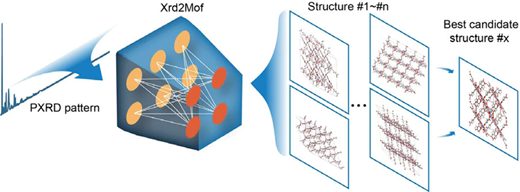

# Xrd2Mof

[Interpreting X-Ray Diffraction Patterns of Metal-Organic Frameworks via Generative Artificial Intelligence](https://doi.org/10.1021/jacs.5c16416)

## Abstract

Xrd2Mof presents a crystal structure generation framework designed to enable
intelligent, high-throughput interpretation of powder X-ray diffraction (PXRD)
patterns and subsequent reconstruction of atomic-level crystal structures for
metal-organic frameworks (MOFs). It leverages pretrained models to extract
salient features from PXRD spectra alongside essential prior information (metal
nodes and organic linkers), facilitating the generation of structural
building-block sites within the unit cell. By employing a coarse-grained (CG)
strategy, Xrd2Mof overcomes the limitations traditionally imposed by atom count
in crystal structure prediction (CSP), and the generated CG structures are the
input of a downstream atomic assembly step, which is not part of this
repository.



---

## Model Description

### Overview

A coarse-grained MOF unit cell is represented as:
- CG atom types (metal node / organic linker): $A = (a_1,\ldots,a_N)$
- fractional coordinates: $X = (x_1,\ldots,x_N),\; x_i \in [0,1)^3$
- lattice matrix: $L \in \mathbb{R}^{3 \times 3}$

Generation is conditioned on a per-sample 256-dim embedding $C$ produced by a
CLIP-style feature extractor. Its five encoders are fused into two 256-dim
embeddings:

| Encoder | Input | Output |
|---------|-------|--------|
| `LatticeEncoder` | lattice matrix (3x3) | 32 |
| `AtomEncoder` | atom positions (50x3) | 256 |
| `XrdEncoder` | PXRD pattern (5250) | 1024 |
| `MetalEncoder` | metal prior (65) | 64 |
| `LinkerEncoder` | linker graph (GCN) | 64 |

`cif_features = lattice(32) + atom(256) = 288`, and
`combined_features = xrd(1024) + metal(64) + linker(64) = 1152`. Both branches
are projected to a shared 256-dim space and trained with an in-batch contrastive
loss; for generation only the `feature_embedding` (PXRD + metal + linker branch)
is used. The pipeline of the original repository is
`create_data/ -> pretrained_model/ -> generation_model/`; this repository
reimplements the last two stages and consumes the CG npz data produced by the
first.

### Method

#### 1) Forward diffusion (corruption)

##### (a) Lattice diffusion (DDPM on $L$)
The lattice is diffused with a standard DDPM Gaussian process
(`DDPMScheduler`, `squaredcos_cap_v2`):

$$
L_t = \sqrt{\bar{\alpha}_t}\,L_0 + \sqrt{1 - \bar{\alpha}_t}\,\epsilon_L,
\qquad
\epsilon_L \sim \mathcal{N}(0, I).
$$

##### (b) Fractional-coordinate diffusion on a torus
The fractional coordinates live on a 3D torus
(`ScoreSdeVeSchedulerWrapped`); Gaussian noise is added and wrapped back into
the unit cell:

$$
X_t = w(X_0 + \sigma_t\,\epsilon_X),
\qquad
\epsilon_X \sim \mathcal{N}(0, I),
\qquad
X_t = X_t \bmod 1.
$$

As $\sigma_t$ increases, the wrapped normal distribution approaches the uniform
distribution over $[0,1)^{3}$.

#### 2) Feature-conditioned denoiser (CSPNet)

The denoiser is a DiffCSP-style CSPNet whose node initialization fuses the CG
atom type embedding, the per-sample PXRD embedding $C$ and the time embedding:

$$
h_i^{(0)} = \rho\left(f_{\text{atom}}(a_i) \oplus C \oplus f_{\text{time}}(t)\right).
$$

Message passing operates on a fully connected CG graph with periodic Fourier
features and the lattice inner product for O(3)-invariance:

$$
m_{ij}^{(s)} = \phi_m\left(
h_i^{(s-1)},\, h_j^{(s-1)},\, \mathrm{vec}(L^\top L),\,
\psi_{\mathrm{FT}}(x_j - x_i)
\right),
$$

$$
h_i^{(s)} = h_i^{(s-1)} + \phi_h\left(h_i^{(s-1)},\,
\sum_j m_{ij}^{(s)}\right).
$$

Outputs are the coordinate score $\hat{\epsilon}_X$ per node and the lattice
noise $\hat{\epsilon}_L$ from the graph-pooled features, rotated by $L$ to keep
$\mathrm{O}(3)$ invariance.

#### 3) Training objective

The lattice branch is trained with plain MSE towards the injected noise; the
coordinate branch regresses the normalized score of the wrapped normal
distribution:

$$
\mathcal{L}
= \lambda_L\,\| \hat{\epsilon}_L - \epsilon_L \|_2^2
+ \lambda_X\,\| \hat{\epsilon}_X - \nabla_{X_t}\log q(X_t \mid X_0) / \mathrm{sigmas\_norm}_t \|_2^2,
\quad
\lambda_L = 0.1,\; \lambda_X = 1.0.
$$

#### 4) Sampling

Sampling follows the predictor-corrector scheme of the original implementation:
1000 inference steps; each step runs a Langevin corrector with step size
(`snr`) 1e-5 followed by an ancestral predictor, the lattice branch takes the
ancestral DDPM step, and the final coordinates are wrapped into $[0,1)$.

---

## Dataset Description

- **BIFWIY, DAKZAS, DUDZOR, VAWXAS01**: four experimental PXRD test cases of
  CSD-derived MOFs. The packaged dataset (`xrd2mof_cgmof50_data.zip`, downloaded
  automatically on first use) contains 16 CG samples covering the
  valence-consistent atom-count configurations of each MOF.

| Split | Samples |
| --- | --- |
| train | 12 |
| val | 4 |
| test | 16 |

> Since the reference CG coordinates are not distributed with the test cases,
> the bundled training/validation structures are synthesized with a fixed seed
> and are intended for smoke training and alignment analysis only. Real
> training requires the full CSD-derived dataset.

Recommended data fields for each sample:
- `feature_embedding`: $[N, 256]$ PXRD embedding from the pretrained feature extractor
- `num_atoms`: $[N]$ CG site count per sample
- `atom_types`: $[\sum \text{num\_atoms}]$, `0` metal node, `1` organic linker
- `frac_coords`: $[\sum \text{num\_atoms}, 3]$ fractional coordinates in $[0,1)$ (train/val only)
- `lengths` / `angles`: $[N, 3]$ lattice parameters (train/val only)
- `mof_id`: $[N]$ sample identifier (test only)

### Data preparation

1. Run the original preprocessing pipeline (`create_data/` and
   `pretrained_model/` in the upstream repository) to obtain the raw records:
   the feature extractor below converts them into one
   `{mof_id, feature_embedding}` record per PXRD pattern.
2. Compute the valence-consistent CG configurations for each MOF (see
   `cal_num_type_to_diffusion_single.py` upstream) to obtain `num_atoms` and
   `atom_types`.
3. Store the arrays as npz files following the field list above, place them
   under `./data/xrd2mof_cgmof50/`, and the dataset classes will pick them up.

The pretrained feature extractor weights ship inside the model package at
`checkpoints/feature_extractor.pdparams`; the input batch keys and shapes are
`cif_lattice [B, 3, 3]`, `cif_atom_positions [B, 50, 3]`, `xrd [B, 5250]`,
`metal [B, 65]` and
`linker {x: [N, 37], edge_index: [2, E], batch: [N]}`:

```python
import os.path as osp

import paddle
from ppmat.models import MODEL_REGISTRY, build_model_from_name
from ppmat.models import resolve_model_package_dir
from ppmat.models.xrd2mof.feature_extractor import Xrd2MofFeatureExtractor
from ppmat.utils import download

path = download.get_weights_path_from_url(MODEL_REGISTRY["xrd2mof_cgmof50"])
package_dir = resolve_model_package_dir("xrd2mof_cgmof50", path)

extractor = Xrd2MofFeatureExtractor()
extractor.set_state_dict(
    paddle.load(osp.join(package_dir, "checkpoints", "feature_extractor.pdparams"))
)
extractor.eval()
outputs = extractor.extract(batch)
feature_embedding = outputs["feature_embedding"]  # [B, 256]
```

---

## Results

| Model Name | Dataset | Val (loss) | Config | Checkpoint / Log |
| --- | --- | --- | --- | --- |
| xrd2mof_cgmof50 | cgmof50 | 4.37 | [xrd2mof_cgmof50.yaml](xrd2mof_cgmof50.yaml) | pending |

Val (loss) is the evaluation loss of the bundled 2-epoch smoke run
(`6.49` at epoch 1 descending to `4.37` at epoch 2); the checkpoint link is
published together with the registry entry.

Deterministic alignment against the original PyTorch implementation
(reference checkpoint `epoch=2284-step=162234.ckpt`):

| Component | Metric | Value |
|-----------|--------|-------|
| Generation decoder (t=100/200/500/800) | pred max abs diff | 3.34e-6 |
| Training loss (fixed timestep/noise, `sigmas_norm` aligned) | max abs diff | 2.0e-5 |
| Feature extractor (`cif_embedding`) | max abs diff | 9.18e-6 |
| Feature extractor (`feature_embedding`) | max abs diff | 1.25e-5 |

These numbers document the migration-time cross-check; the residual gap comes
from scheduler differences (the upstream cosine beta clip `0.9999` vs the shared
`DDPMScheduler` bound `0.999`, and the Monte-Carlo `sigmas_norm` table, which is
re-sampled per framework build).

---

## Command

### Training
```bash
# multi-gpu training (example with 4 GPUs)
python -m paddle.distributed.launch --gpus="0,1,2,3" structure_generation/train.py -c structure_generation/configs/xrd2mof/xrd2mof_cgmof50.yaml
# single-gpu training
python structure_generation/train.py -c structure_generation/configs/xrd2mof/xrd2mof_cgmof50.yaml
```

### Validation
```bash
# Adjust program behavior on the fly using command-line parameters without modifying the configuration file directly.
# Example: --Global.do_eval=True
python structure_generation/train.py -c structure_generation/configs/xrd2mof/xrd2mof_cgmof50.yaml Global.do_eval=True Global.do_train=False Global.do_test=False Trainer.pretrained_model_path='path/to/model.pdparams'
```

### Testing
```bash
# Since the bundled test split provides PXRD embeddings only (no reference
# coarse-grained structures to compute the loss), this model does not use the
# test command.
```

### Sample
```python
# Predict coarse-grained CG structures using a trained model.
# Mode 1: Use a pre-trained model (downloads automatically).
# Mode 2: Use a custom configuration file and checkpoint.
# Results are saved to the folder specified by output_dir below; CIF assembly
# does not apply to the coarse-grained output, so each item is persisted as npz
# with the same fields as the dataset (`lattice`, `frac_coords`, `atom_types`,
# `num_atoms`, `mof_id`). Sampling settings: 1000 inference steps, `snr` 1e-5.

# Mode 1: pre-trained model
import os

import numpy as np
from ppmat.datasets import build_dataloader
from ppmat.models import build_model_from_name

output_dir = "results/xrd2mof"
os.makedirs(output_dir, exist_ok=True)

model, config = build_model_from_name("xrd2mof_cgmof50")
model.eval()
loader = build_dataloader(config["Sample"]["data"])
batch = next(iter(loader))
result = model.sample(batch, num_inference_steps=1000)["result"]
for index, item in enumerate(result):
    np.savez(
        os.path.join(output_dir, f"{item['mof_id']}_{index + 1}.npz"),
        lattice=np.asarray(item["lattice"], dtype="float32"),
        frac_coords=np.asarray(item["frac_coords"], dtype="float32"),
        atom_types=np.asarray(item["atom_types"], dtype="int64"),
        num_atoms=np.asarray(item["num_atoms"], dtype="int64"),
        mof_id=str(item["mof_id"]),
    )

# Mode 2: custom config + checkpoint
from omegaconf import OmegaConf

from ppmat.models import build_model
from ppmat.utils import save_load

config = OmegaConf.load("structure_generation/configs/xrd2mof/xrd2mof_cgmof50.yaml")
model = build_model(OmegaConf.to_container(config["Model"], resolve=True))
save_load.load_pretrain(model, "path/to/model.pdparams")
model.eval()
# ... same sampling loop as Mode 1 on the batch you build.
```

---

## Citation

```bibtex
@article{feng2026xrd2mof,
  title   = {Interpreting {X}-ray Diffraction Patterns of {M}etal-{O}rganic Frameworks via Generative Artificial Intelligence},
  author  = {Feng, Bin and Wang, Bingxu and Lv, Linpeng and Zhang, Mingzheng and Chen, Zhefeng and Pan, Feng and Li, Shunning},
  journal = {Journal of the American Chemical Society},
  volume  = {148},
  number  = {1},
  pages   = {869--878},
  year    = {2026},
  doi     = {10.1021/jacs.5c16416}
}
```

The upstream implementation is available at
[PKUsam2023/Xrd2Mof](https://github.com/PKUsam2023/Xrd2Mof).
